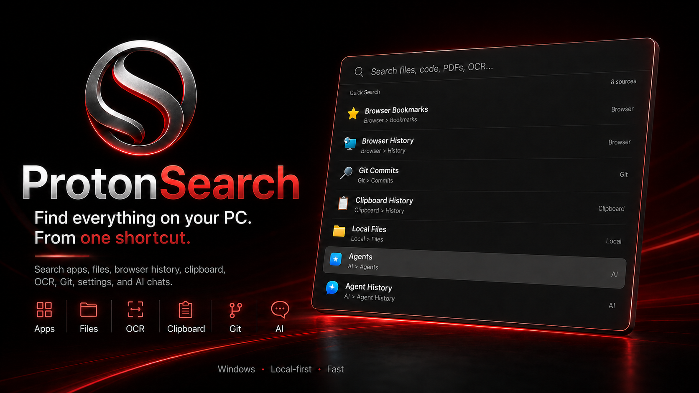

<p align="center">
  
</p>

<h1 align="center">ProtonSearch</h1>

<p align="center">
  <em>Find everything on your PC. From one shortcut.</em>
</p>

<p align="center">
  
  <a href="LICENSE"></a>
  <a href="https://github.com/PranshulSoni/protonsearch/stargazers"></a>
  <a href="https://github.com/PranshulSoni/protonsearch/releases"></a>
</p>

ProtonSearch is a search launcher for Windows that lives in a Dynamic Island at the top of your screen. Press `Alt + Space`, type what you remember, press `Enter`. Everything is indexed on your own PC.

<p align="center">
  
</p>

## What it does

**Search**

- Files, folders and apps by name.
- Text inside documents: PDF, Word, Excel, Markdown, plain text and code.
- Text inside images and screenshots, read by OCR that runs on your PC.

**Cards** that you scroll or swipe through in the island:

- **Clipboard**: everything you copied, text and images.
- **Browser**: history from every installed browser and profile.
- **Media**: play, pause and skip whatever is playing.
- **Quick settings**: Wi-Fi, Bluetooth, volume and audio output.
- **To-do**: a list with due dates.
- **Git**: recent commits and branches in your repositories.
- **Agents**: AI agents powered by [Pi](https://www.npmjs.com/package/@earendil-works/pi-coding-agent), using your own provider: OpenAI, Anthropic, OpenRouter or any OpenAI-compatible endpoint.

**Look**: a liquid glass or solid black island, in light or dark mode.

## Fast

The ProtonSearch numbers are our own measurements on the maintainer's PC, using a synthetic corpus of 100,000 files. The Kensaku numbers are the Windows figures [Kensaku](https://github.com/yjid/kensaku) publishes. They come from different machines, so read this as a rough comparison, not a controlled benchmark.

| | ProtonSearch (our measurement) | Kensaku (published) |
|---|---|---|
| File name search | 0.42 ms average, p99 ~1.5 ms | 3.1–18 ms average |
| Memory per indexed file | ~126.6 bytes | ~128 bytes |
| Folder walk | ~16,000 files/s | ~10,000 files/s |
| OCR | ~39 screenshots/s (4 parallel workers) | ~17 screenshots/s |

## Install

1. Download the latest release from [GitHub Releases](https://github.com/PranshulSoni/protonsearch/releases).
2. Run it. You need Windows 10 or 11 (64-bit) and the Microsoft Edge WebView2 runtime, which Windows 11 already includes.

Coming from ProtonSearch 1.x or OmniSearch? On first run your settings, indexed files and document text are imported, and the old data folder is left untouched.

## First run

A short setup asks for:

1. **Your name.**
2. **An OCR engine**: Windows OCR (built in, nothing to download), PP-OCRv6 (~6 MB download), Indra OCR (~27 MB, better with rotated and multilingual text) or Tesseract (uses your own install).
3. **A look**: liquid glass or black, light or dark.
4. **A hotkey**: `Alt + Space` by default. Pick another one if something else already uses it.

You can change all of these later in Settings. Agents are optional; they need Node.js, and ProtonSearch can install Pi for you after you review what it will install.

## Privacy

Your index, clipboard and browser history stay on your PC, in `%APPDATA%\protonsearch\v2`. There is no telemetry and no account. Agents only talk to the AI provider you set up.

## Updates

Open **Settings → Check for updates**.

## For developers

### Build from source

You need Windows 10/11, Rust (stable, MSVC toolchain) and Node.js. Tested with Rust 1.99 and Node 26.

```powershell
cd apps/desktop
npm install
npm run tauri build -- --no-bundle
```

The app is written to `target\release\ProtonSearch.exe`. For a dev build with hot reload, run `npm run tauri dev` instead. Troubleshooting and packaging notes are in [docs/release/BUILD.md](docs/release/BUILD.md).

### Project layout

```text
apps/desktop/        Tauri 2 desktop app
  src/               React + TypeScript UI: island/, launcher/, app/ (main window, settings), onboarding/
  src-tauri/         Rust host: windows, tray, global hotkey, commands
crates/
  ps-core            engine: query coordination, ranking, settings, v1 migration
  ps-index           in-memory file name index
  ps-content         document text extraction and SQLite FTS5 content search
  ps-ocr             OCR pipeline and engines
  ps-sources         apps, clipboard, browser history, Git, recent files, calculator, actions
  ps-windows         Win32 helpers: icons, shell open, clipboard, windows
  ps-agent           Pi agent runs and task history
  ps-ipc             types shared by the Rust side and the UI
  ps-bench           benchmark harness behind the numbers above
docs/                design notes, ADRs, benchmarks, release docs
```

### Tests

```powershell
cargo test --workspace   # Rust crates and the Tauri host
cd apps/desktop
npm test                 # UI tests (Vitest)
```

## License

MIT. See [LICENSE](LICENSE).

## Credits

Name of project and Tester : https://github.com/AryanMotiani \
Marketing of the project: https://github.com/dweep-desai
